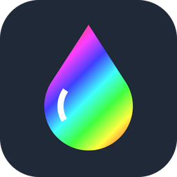

<p align="center"></p>

# 🎨 Iro — Color Picker
[](https://opensource.org/licenses/MIT)

Pick any color from anywhere on your screen. 💧  
Press a shortcut, point at a pixel with the magnifier, click, and the color is on your clipboard: `#1A73E8`, `rgb(26, 115, 232)`, `hsl(…)`… whatever you need.

Iro lives in the notification area, uses almost no memory and works **offline**, on your PC.

---

## 🚀 Features

- 💧 **Pick a color** (`Ctrl + Alt + C`): a magnifier follows your pointer over a frozen copy of the screen, so you hit the exact pixel. Click and the color is copied
- 🔍 Zoom in or out with the **mouse wheel**; move **one pixel** at a time with the **arrow keys** (ten with `Shift`)
- 🧾 **Several formats**: HEX, RGB, HSL, HSV, CMYK or plain `R, G, B`. Choose the one you copy by default, and the magnifier shows the color in it as you go
- 🕘 **Recent colors**: your last 24 colors, in the tray menu and in the **Colors** window
- 🖌️ **Colors window**: the selected color large, in every format with its own copy button
- 🖱️ Left-click the tray icon to pick; right-click for the menu
- 🔒 100% offline: nothing leaves your PC. No telemetry, no accounts
- 🖥️ Multiple monitors, mixed DPI scaling and monitors placed left of or above the main one
- 🌙 Clean Windows 11 look that follows your light or dark theme and accent color
- 🪶 Tiny: ~0.5 MB of memory and 0% CPU while idle, a ~2.2 MB installer, no .NET or Visual C++ runtime needed
- 🚦 Starts with Windows (you can turn it off)

---

## 📦 Install

Download `IroSetup.exe` from [Releases](https://github.com/VitomDev/Iro-Color-Picker/releases/latest) and run it.

> 🧰 **Recommended:** install it with [Vitool Box](https://github.com/VitomDev/Vitool-Box), which keeps all VitomDev apps in one place and installs or removes them with a switch.

- Per-user install, no admin rights needed
- Iro starts right away and its icon appears in the notification area
- It starts with Windows from then on

Uninstalling (Settings → Apps) removes Iro, its startup entry, its settings and its recent colors.

---

## 🖱️ Usage

| Action | How |
| --- | --- |
| Pick a color | `Ctrl + Alt + C`, or left-click the tray icon, then click the pixel |
| Move one pixel | Arrow keys (`Shift` + arrow: ten pixels), then `Enter` or `Space` to pick |
| Zoom the magnifier | Mouse wheel |
| Cancel | `Esc` or right-click |
| Copy a recent color again | Right-click the tray icon and click the color |
| Change the copied format | Right-click the tray icon → **Copy as** |
| All formats of a color | Right-click the tray icon → **Colors…** |
| Settings | Right-click the tray icon → **Settings** |
| Exit | Right-click the tray icon → **Exit Iro** |

After picking, a small note with the color sample (*#1A73E8 copied*) appears next to the pointer and fades away. Just paste with `Ctrl + V`.

In the **Colors** window, click a recent color to see it in every format, use the copy button next to the one you want, or double-click a color to copy its HEX value.

### 🧾 Formats

| Format | Example |
| --- | --- |
| HEX | `#1A73E8` |
| RGB | `rgb(26, 115, 232)` |
| HSL | `hsl(214, 82%, 51%)` |
| HSV | `hsv(214, 89%, 91%)` |
| CMYK | `cmyk(89%, 50%, 0%, 9%)` |
| R, G, B | `26, 115, 232` |

HEX, RGB and HSL paste straight into CSS. CMYK is the simple conversion design tools show, without a print color profile.

### ⚙️ Settings

- **Shortcut** to pick a color
- **Copy as**: the format copied after picking
- **Recent colors**: remember them or not, and clear them
- **Start with Windows**

---

## ⚡ Performance

Measured on the development PC (Windows 11):

| | |
| --- | --- |
| Idle CPU (60 s) | 0 ms |
| Idle memory | 0.5 MB working set, 1.8 MB private |
| Idle threads | 1 |
| `Iro.exe` / installer | 0.4 MB / 2.2 MB |

---

## 🔧 Build

Requirements: Visual Studio 2022 or newer with the C++ x64 tools and Inno Setup 6 (`winget install JRSoftware.InnoSetup`).

```powershell
.\build.ps1
```

It downloads the pinned build tools into `.deps/` (Windows SDK, CMake and Ninja, all verified by hash), builds everything, runs the tests and writes the installer to `dist/IroSetup.exe`.

`.\build.ps1 -SkipTests` and `.\build.ps1 -SkipInstaller` skip those steps.

---

## 📚 Dependencies

None: Iro only uses Windows' own APIs. 🧘

---

## 🪟 Compatibility

Windows 10 (version 1809 or newer) and Windows 11, 64-bit.

---

## 🧪 Project Status

✅ Stable.  
This project is fully functional as-is and ready to use.
Future updates to improve features or the interface are not ruled out.

---

## 📄 License

[MIT](LICENSE) © VitomDev

---

## 📲 Contact

Feel free to reach out or follow me:

- 🐙 GitHub: [@VitomDev](https://github.com/VitomDev)
- 🐦 Twitter/X: [@VitomDev](https://twitter.com/VitomDev)
- 🎮 Twitch: [@VitomDev](https://www.twitch.tv/VitomDev)
- 💼 LinkedIn: [VitomDev](https://www.linkedin.com/in/víctor-escós-batalla/)
